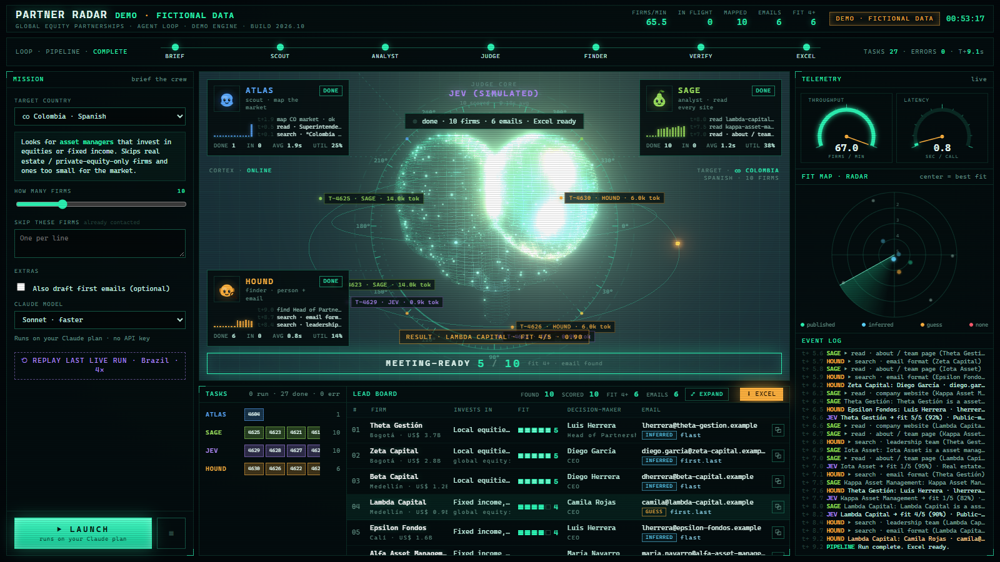

# Partner Radar

Pick a country. A small crew of AI agents finds the local asset managers, scores how good a partner each one is, finds the right person to talk to and their email, and hands you an Excel sheet sorted by best fit.

It runs on **your own Claude plan** through Claude Code. No API keys, nothing to pay per run.

## The crew

| Agent | Job |
|---|---|
| **ATLAS** · scout | Maps the market's asset managers, starting from the securities regulator's register and industry-association lists |
| **SAGE** · analyst | Reads each firm: assets under management, what they invest in, who they serve, leadership |
| **JEV** · judge | Scores partner fit 1–5 with a confidence and a one-line reason |
| **HOUND** · finder | Finds the CEO (or head of partnerships / distribution) and their email |

You see what they're doing live: every search and page read shows up on screen.

### How firms are scored

- **Good fit:** asset managers that invest in public markets (equities and/or fixed income). Adding a global equity strategy is a natural next step for them. Already offering some global equity is fine.
- **Not a fit:** firms that only do real estate, private equity, infrastructure or private credit.
- **Size** is judged relative to the country (around US$100M is usually too small).

### How emails are labeled

| Label | Meaning |
|---|---|
| **Published** | Seen on a public page |
| **Inferred** | Built from the firm's email pattern; the example it used is shown |
| **Guess** | Common format, no example found. Double-check before sending |
| **Verified** | Checked by Hunter (optional free key) |
| **No mail server** | The domain doesn't accept email, so don't use it |

## Run it

You need:

1. **Claude Code**, installed and signed in with a Claude Pro or Max plan: https://claude.com/claude-code
2. **Node.js** (free, LTS): https://nodejs.org

Then:

- **Windows:** double-click `Start Partner Radar.bat`
- **Mac:** right-click `Start Partner Radar.command` → Open (the first time only)
- **Or from a terminal:** `npm install` then `npm start`

Your browser opens http://localhost:4747. Pick a country, choose how many firms (start with 5–10), click **LAUNCH**. About 4–5 minutes for 8 firms on Sonnet. Click any row for the details, then **Download Excel**.

Big runs use more of your Claude plan's limits, so start small.

## Optional extras

Copy `.env.example` to `.env`:

- `HUNTER_API_KEY` verifies emails before you send (free tier at hunter.io).
- `FIRECRAWL_API_KEY` reads company websites more cleanly (free tier at firecrawl.dev).

## Notes

- Everything runs locally. It only reads public web pages.
- It doesn't send anything. You review the sheet and reach out yourself.
- Each run is saved in `runs/` so you can replay it with **Replay last live run**.
