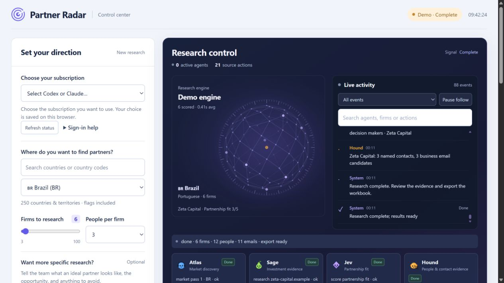

# Partner Radar

Research financial partners worldwide using **your Codex / ChatGPT subscription or your Claude subscription**. Choose the provider in the dashboard; your choice is remembered. Research consumes that plan's normal limits. Optional contact-data services use their own keys and credits.



## What changed in version 3.1

- **Email candidates for named contacts:** public company examples teach observed formats, including documented parent-company mail domains. Remaining gaps get a plausible name-and-company-domain address labeled **Guess**. Blank addresses are reserved for unusable names, missing business domains or exhausted distinct candidates; the contact and Excel explain the reason.
- **Focused control dashboard:** research setup starts directly below the header, with the agent workspace and results beside it.
- **Visible live activity:** searchable task, search, page-read, result and issue events, with filters and a pause-follow control. Pausing keeps collecting new events.
- **Motion tied to research:** active agents light up and the signal globe reacts to actual events. Motion rests when research ends, the page is hidden, or reduced motion is enabled.
- **Responsive cancellation:** stopping a fictional demo interrupts its current delay immediately and preserves partial results.

## What changed in version 3

- **A clearer research studio:** larger text, readable contact details, a focused research form and a live agent workspace. Advanced options stay available without crowding the main flow.
- **Your own research brief:** “Want more specific research?” lets you describe the ideal partner, opportunity, priorities and exclusions. The brief guides scouting, company analysis, scoring and contact research.
- **Targeted follow-ups:** agents inspect missing people, usable email evidence, LinkedIn profiles and role evidence, then make one focused repair pass rather than repeating an unfocused search.
- **Time ranges before launch:** a planning estimate responds to firm count, depth, contacts, drafts and provider. It uses local successful-call timings when available, then updates remaining work from actual pipeline stages. Estimates are approximate.
- **Richer exports:** individual LinkedIn links, public professional phones, direct-line/company-switchboard labels, source URLs, role evidence, timestamps and next actions. Missing or unsupported details remain blank.
- **Research quality:** a firm evidence file and coverage summary show what was found, what remains uncertain and the next useful action. [Research behind the changes](docs/RESEARCH-NOTES.md).

The version 2 foundations remain:

- **250 destinations:** all 249 ISO countries and territories, plus Kosovo, with emoji flags, region groups and country search.
- **More coverage:** up to 100 firms, several discovery passes through regulators, associations and local-language sources, with duplicate firms removed.
- **Multiple people:** request 1–8 contacts per firm, select decision-maker roles, and inspect every person's email, role and evidence in the details drawer.
- **Research controls:** balanced or deep research, institution types, minimum fit and exclusions. Smaller runs are a useful first check; results depend on public information and your provider limits.
- **Visible integrations:** connect, test or disconnect Hunter, Apollo and Firecrawl without editing a file. Keys remain on your computer in the ignored `.env` file.
- **Useful outputs:** an Excel firm overview and separate Contacts sheet, plus a CSV with one row per person. Both retain email status and source evidence.
- **Reliable progress:** subscription sign-in checks, streaming activity, cancellation, clear partial/failed outcomes and saved results after refresh or server restart.

## Start

Install [Node.js LTS](https://nodejs.org/) (20 or newer) and either CLI:

| Provider | Install and sign in |
| --- | --- |
| Codex | `npm install -g @openai/codex`, then `codex login` and choose ChatGPT sign-in. [Official setup](https://developers.openai.com/codex/cli/) |
| Claude | Install [Claude Code](https://code.claude.com/docs/en/setup), then run `claude` and sign in with your eligible Claude subscription. |

An installed CLI is not automatically a signed-in subscription. Partner Radar checks the login method and asks you to fix setup when needed. It does not use API credentials for subscription research. Codex uses the installed CLI's default model unless `CODEX_MODEL` is set; Claude offers Sonnet and Opus.

On Windows, double-click **Start Partner Radar.bat**. On macOS, open **Start Partner Radar.command**. From a terminal:

```sh
npm ci
npm start
```

Open [localhost:4747](http://localhost:4747), choose **Codex** or **Claude**, select a country, add a specific brief if needed and review the time estimate before launching. The explicitly labeled demo uses fictional `.example` data and does not make AI calls. Keep the terminal open while the app runs.

## Hunter, Apollo and Firecrawl

Expand **Connections** in the dashboard. Use **Get key**, paste the key into its masked field, click **Connect**, then **Test**. A saved key is labeled configured; a successful connection test is labeled ready. Connection tests do not prove every enrichment endpoint is included in your account.

| Service | Automatic dashboard use | Setup |
| --- | --- | --- |
| Hunter | Discover named business contacts, find emails for known people and check deliverability. The activity log and each contact show Hunter when used. | [API key](https://hunter.io/api-keys), [API documentation](https://hunter.io/api-documentation/v2) |
| Apollo | Enrich known decision-makers with company work emails, matching name and company. It does not request personal emails or phone numbers. A Hunter check can then verify the result. | [API key](https://developer.apollo.io/#/keys), [API access and credits](https://docs.apollo.io/reference/people-enrichment) |
| Firecrawl | Read official company pages for public contact evidence when available. | [API key](https://www.firecrawl.dev/app/api-keys), [documentation](https://docs.firecrawl.dev/) |

Alternatively copy `.env.example` to `.env` and fill the selected keys. Never commit `.env` or run logs. Failed or rate-limited enrichment retains public research and reports a warning. Contact lookups and verification may consume vendor credits; quotas vary by account.

### Easy MCP setup

The Connections panel offers **Add MCP** for the documented remote [Hunter](https://hunter.io/mcp) and [Apollo](https://docs.apollo.io/docs/apollo-mcp) servers in your chosen CLI. It registers the service and shows the sign-in step. Authentication still requires completing the provider's account flow. Existing servers with conflicting names are preserved.

These MCP registrations are available to your CLI sessions. **Partner Radar's automatic contact enrichment uses the API keys above.** An MCP login and an API key connection are separate; MCP registration alone does not activate dashboard enrichment.

| Service | Official remote endpoint |
| --- | --- |
| Hunter | `https://mcp.hunter.io/mcp` |
| Apollo | `https://mcp.apollo.io/mcp` |

For Codex, registration can also be done with `codex mcp add apollo --url https://mcp.apollo.io/mcp`, followed by `codex mcp login apollo`. For Claude Code, use `claude mcp add --scope user --transport http apollo https://mcp.apollo.io/mcp`, then open Claude and use `/mcp` to authenticate. Hunter and Firecrawl setup links are included in the dashboard; follow their official instructions for supported authentication.

## Evidence and email status

**Found using** and **Verified using** are separate fields. A database match or a domain with mail servers is not proof that a mailbox accepts messages.

| Status | Meaning |
| --- | --- |
| Published | A public source identifies the address. Source links are retained. |
| Inferred | Based on an evidenced company email pattern or provider finder; it is not a published address. |
| Guess | A plausible address from the researched name and company domain, without supporting pattern evidence. The assumed format is shown. |
| Verified | Hunter returned a valid/deliverable result. |
| Catch-all | The domain accepts arbitrary recipients; the individual mailbox remains uncertain. |
| Unverified | Deliverability could not be confirmed. |
| Invalid / No mail server | Excluded from usable-email totals. |

The app prioritizes asset managers investing in public markets. Selecting banks, wealth managers, brokers, insurers, platforms or family offices adjusts discovery and fit scoring. It does not invent firms or people to fill a requested target; small markets and incomplete public sources can yield fewer results. Review roles, sources and addresses before outreach. The app drafts text when requested and never sends outreach.

Runs are stored locally in `runs/`. Live results reopen after a page refresh; stopped or interrupted runs retain their partial data. Exported contacts remain available after restarting the server.

## Development

```sh
npm ci
npm run check
npm test
```

Regression tests use fake CLIs and mocked network responses for subscription authentication, output parsing, cancellation, scouting, adaptive evidence repair, public business phones, individual LinkedIn profiles, time ranges, integration keys, email verification, countries, exports and saved-run recovery. These checks establish implementation behavior; public-web coverage still varies by country and source.
